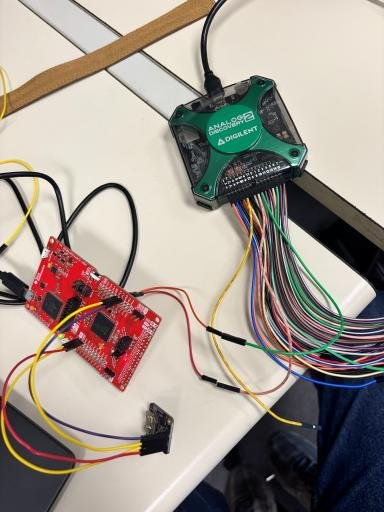
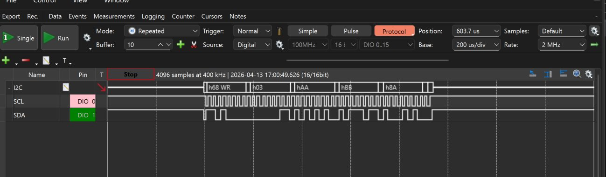
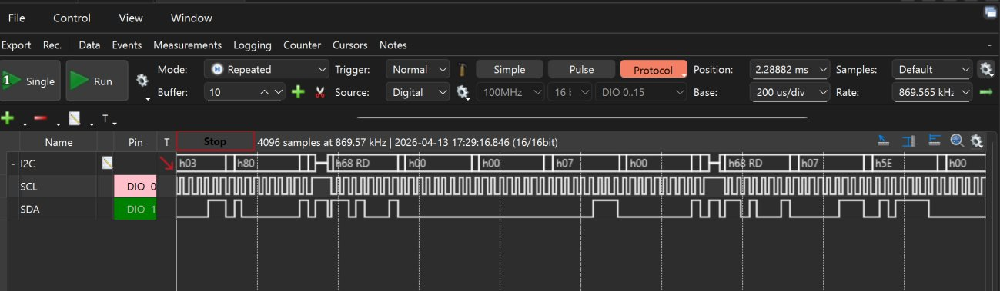

# ⏱️ ChronoBus — Bare-Metal I²C Real-Time-Clock Driver (MSP432 + PCF8523)

> **Talking to time: a bare-metal I²C driver for the PCF8523 real-time clock.**


Bare-metal **I²C** driver for the **MSP432P401R** eUSCI_B0 module, talking to an **Adafruit PCF8523** real-time-clock breakout (7-bit address **0x68**). The master writes a 3-byte packet to the RTC and reads data back; the bus traffic was verified with a **Digilent Analog Discovery** logic analyzer in **WaveForms**.

<p align="center"></p>

## Hardware & Software

- TI **MSP-EXP432P401R** LaunchPad
- **Adafruit PCF8523** RTC breakout (on-board SDA/SCL pull-ups)
- Digilent Analog Discovery + **WaveForms** (optional, for waveform capture)
- **Code Composer Studio** + **SimpleLink MSP432 SDK**

| MSP432 | PCF8523 |
|---|---|
| P1.6 (UCB0SDA) | SDA |
| P1.7 (UCB0SCL) | SCL |
| 5V | VIN |
| GND | GND |

## Configuration

| Setting | Value |
|---|---|
| Clock | DCO = 12 MHz, SMCLK = DCO/2 = **6 MHz** |
| Bit rate | BRW = 60 → **100 kHz** (standard mode) |
| eUSCI_B0 | `MODE_3` (I²C), `MST`, `UCSSEL` = SMCLK, auto-STOP after `TBCNT` (`ASTP_2`) |
| Slave address | `I2CSA = 0x68` |
| Write | `TR = 1`, `TBCNT = 3`, packet `{0x03, 0xAA, 0xBB}` (register 0x03 + 2 data bytes) |
| Read | `TR = 0`, `TBCNT = 4`, bytes captured in the RX interrupt |

## Repository Structure

```
├── i2c_master_write/main.c   # MSP432 → PCF8523: START, addr+W, 3 bytes, auto-STOP
├── i2c_master_read/main.c    # PCF8523 → MSP432: START, addr+R, 4 bytes, auto-STOP
└── images/
```

## Build & Run

1. Create an empty **MSP432P401R** CCS project for each folder and use its `main.c`.
2. Wire the board to the PCF8523 as shown above.
3. Flash and run; probe SDA/SCL with the logic analyzer (I²C decoder) or watch `Data_In` in the CCS debugger.

## Results

| Master write (0x68 W, 0x03 0xAA 0xBB) | Master read |
|---|---|
|  |  |

## I²C in brief

- Two open-drain lines – **SDA** (data) and **SCL** (clock, driven by the master) – with pull-up resistors.
- Frames: START → 7-bit address + R/W → ACK → data bytes (ACK each) → STOP.
- SDA may only change while SCL is low; START/STOP are SDA transitions while SCL is high.
- Multi-master/multi-slave on two wires; half-duplex and slower than SPI.

## Implementation Notes

- The clock system is configured explicitly (12 MHz DCO, 6 MHz SMCLK) so BRW = 60 gives exactly 100 kHz.
- Auto-STOP (`ASTP_2`) with a byte counter (`TBCNT`) lets the hardware end each transfer without CPU intervention.
- TX/RX are handled in `EUSCIB0_IRQHandler` using the interrupt vector register (`IV`).

## Concepts Covered

- eUSCI_B architecture and I²C-mode registers (CTLW0/1, BRW, I2CSA, TBCNT, IFG, IV)
- Clock-system configuration (DCO, SMCLK dividers)
- Pin muxing P1.6/P1.7 for SDA/SCL
- Debugging serial buses with a logic analyzer

## Authors

- **Shrinath Abhay Palwankar**
- **Aryan Verma**
